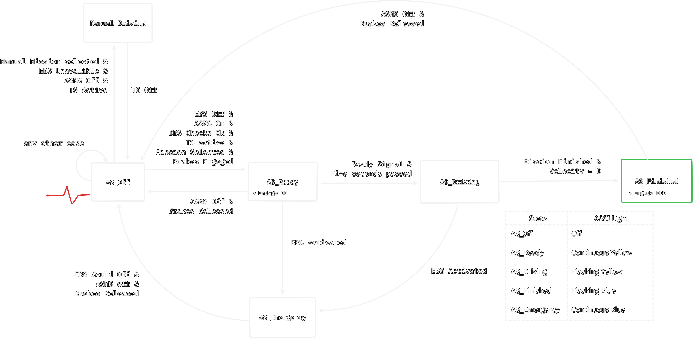

# Driverless Mission Status
A high level state machine to determine what actions the car will take.
## Project Goals
* Define a 3-Tier Hierarchical State Machine (HSM): Strictly decouple competition rule-mandated safety states (Level 1) from mission behavioral logic (Level 2) and low-level actuator control (Level 3).
* Determine ownership over implementing different hierarchies (ex. Path Planning may implement micro-states within Driving macro-state)
* Define an interface for other developers to interact with the state machine.
* Discuss required safety checks we may want to have for the system (heartbeat, auto e-stop on disconnect via watchdog, etc)
    * This is currently incomplete.

## Top-Level States (Level 1)
Within an HSM, primary states are the highest level states, dictating the mandatory, rule-defined modes for the car. 
In the driverless supplement, five states are defined with clear rules for determining which state the car is currently in. 
There are five states defined by the FSAE Driverless Supplement:
* **`AS_Off`**: Car is powered off, EBS is off.
* **`AS_Ready`**: Mission is selected, all checks pass, brakes on.
* **`AS_Driving`**: Car is currently driving through a course.
* **`AS_Finished`**: Car has come to a standstill and finished the driving mission.
* **`AS_Emergency`**: EBS Activated, mission not finished, or vehicle not still, or SDC is open at RSS.

FSAE Driverless Supplement Flow Chart:


Transitions and checks between each state is well defined within the FSAE Driverless supplement, and checks will be owned by the state machine. 

### Inputs:
* EBS Status
* DSMS Status
    * Note: DSMS (Driverless System Master Switch) allows voltage supply to the steering and braking actuators. See Appendix.
* DBS Check Status
* TS Status
* Mission to be selected
* Brake status
* SDC status

### Outputs:
* Current state of car
* Error code if car enters emergency state (See level 2)

### Diagrams:
Figure (1): A rough look at the organization of the macro-states. 
[](https://www.tldraw.com/f/MxO4D-sZBTgFN9DH6k-WZ?d=v0.0.1975.1346.page) 

The mandatory checks and well defined rules should force the driverless car to adhere to competition rules and standards. 


### Sources
[FSAE Driverless Supplement 2027](https://fsaeonline.com/cdsweb/gen/DownloadDocument.aspx?DocumentID=eb98394b-6560-4ee3-a7ae-eea0debe87c7)

[Design of autonomous control systems for a Driverless race car: Remote Emergency System and Autonomous State Machine](https://webthesis.biblio.polito.it/16282/1/tesi.pdf)

## Behavioral Sub-States (Level 2)
Behavioral Sub-states will make up the second layer of the hierarchical state machine. These states will determine autonomous task planning, and behavioral logic. Level 2 activates exclusively when Level 1 is in `AS_Driving` (plus potetntial diagnostic reporting in `AS_Emergency`).
For example, behavioral sub-states would determine the behavior of the car during different events, such as skid-pad or autocross. 
These will mainly be used to determine car behavior during the "driving" state, but will also be used to determine car behavior during emergency states.
### Example states
* Test Subsystems (MVP/Inspection)
* Exploration (Mapping First Lap)
* Slowing to a stop
* Straight line Acceleration
* Skid-Pad First Lap

### Example Transition | Mission_Acceleration
* `AS_Driving`: `Straight_Line_Accel` $\rightarrow$ `Cross_Finish_Line` $\rightarrow$ `Slowing_To_Stop` $\rightarrow$ signals `AS_Finished`.
    * Any sub-state can trigger `AS_Emergency` / `EBS`

### Scope
For this project, an interface will be implemented to serve as a template for sub-states. This interface will then be used by other teams to implement more specific areas of the vehicle behavior i.e. exact states for driving will be implemented by the path-planning team.

> Python Concept:
```python
class BehavioralSubState:
    def on_enter(self, context) -> None:
        """Called once when entering this sub-state."""
        pass

    def update(self, context) -> str:
        """
        Executed every tick while in AS_Driving.
        Returns next sub-state name, or 'FINISHED' / 'EMERGENCY'.
        """
        raise NotImplementedError

    def on_exit(self, context, bool: interupted = false) -> None:
        """Cleanup called before transitioning to the next sub-state."""
        pass
```


## Actuation Commands (Level 3)
Actuation commands interact directly with the car, giving it low level commands such as requesting a desired throttle, or desired turning angle.
This is part of the architecture, but defining how our driverless system will interact with the hardware is out of scope for this project. An interface would be developed for python scripts to interact with the car. The state machine acts as the safety multiplexer for Level 3 commands. 
Some  examples may include:
* When `State == AS_Driving`: Passes desired steering angle ($\delta_{\text{cmd}}$), throttle/torque ($T_{\text{cmd}}$), and brake request ($B_{\text{cmd}}$) from the active Level 2/Controls pipeline to the VCU bridge.
* When `State != AS_Driving`: Hard-overrides all outgoing actuation messages to `throttle = 0.0`, `steering = 0.0`, and commands full service/`EBS` braking as required by the active Level 1 state. See the `AS_Ready` and `AS_Finished` states in Figure (1).

## Roadmap

### Phase 1: Architecture & Mock Simulation (1-2 Weeks)
* Deliverables: Finalize pub/sub message definitions; implement the Level 1 State Machine in Python; build a CLI/GUI Mock VCU Publisher that lets developers toggle `DSMS`, `EBS`, `SDC`, and `RES Go`/`R2D` in software.
* Milestone (M1): Pass unit tests covering every arrow in the Level 1 diagram (including the 5-second `AS_Ready` timer and fault injections).

### Phase 2: Level 2 Plugin API & "Test Subsystems" MVP State (Weeks 3–4)
* Deliverables: Build the `BehavioralSubState` base class and implement the Autonomous Inspection Mission (open-loop sine-wave steering + low-speed wheel rotation + controlled stop to `AS_Finished`).
* Milestone (M2): Full end-to-end software loop (`AS_Off` $\rightarrow$ `AS_Ready` $\rightarrow$ `AS_Driving` [Inspection] $\rightarrow$ `AS_Finished`) verified in simulation with Path Planning & Controls leads signing off on the API template.

### Phase 3: Hardware-in-the-Loop (HIL) & Bench Integration (Weeks 5–6) (Winter Quarter)

* Deliverables: Connect compute unit to the VCU over the actual pub/sub bridge on the bench; verify DSSI LED indicator states, and watchdog trip latency ($< 200\text{ ms}$).
* Milestone (M3): Car on jackstands successfully executes the Inspection Mission triggered by the physical RES button and transitions cleanly to `AS_Finished`.

### Phase 4: Dynamic Event Integration (Weeks 7–8)

* Deliverables: Integrate Path Planning's `Acceleration` and `Skidpad` Level 2 sub-states; validate standstill detection ($v_x = 0$) using real wheel odometry.
* Milestone (M4): Complete Critical Design Review (CDR) and first rolling autonomous straight-line test.

## Appendix:
* TS: Tractive System
* R2D: Ready-to-Drive, it is typical of the electric vehicles and it means that the motor
can respond to the position of the accelerator pedal, measured thanks to a position
sensor
* SA: Steering Actuator
* SB: Service Brake
* EBS: Emergency Brake System
* DSSI: Driverless System Status Indicator, it is a LED lamp indicating the actual
state of the vehicle. There are three DSSIs on the vehicle; two must be located on
each side of the vehicle behind the driver’s compartment in a specific region below
the main hoop, while the other one must be positioned in the rear, on the vehicle
centreline. To favour the visibility of the light also in sunlight, they have a dark
background
* **DSMS**: Driverless System Master Switch, a switch that allows the voltage
supply to the steering and braking actuators
* VSU: Vehicle Control Unit

### Sources & Architectural References

1. [Official Rulebook (Level 1 Macro-States & Safety Logic):](https://fsaeonline.com/cdsweb/gen/DownloadDocument.aspx?DocumentID=eb98394b-6560-4ee3-a7ae-eea0debe87c7)

2. **Subsystem & State Machine Design Precedent:**
   * Sorrentino, G. (2020). [*Design of autonomous control systems for a Driverless race car: Remote Emergency System and Autonomous State Machine*](https://webthesis.biblio.polito.it/16282/1/tesi.pdf). Politecnico di Torino. ~ Reference for mapping hardware RES/EBS signals and safety checks into the high-level state transitions.

3. **Full-Stack FSD System Architecture (Level 2 & Level 3 Decoupling):**
   * Kabzan, J., et al. (2020). *AMZ Driverless: The Full Autonomous Racing System*. Journal of Field Robotics, ETH Zurich. [arXiv:1905.05150](https://arxiv.org/abs/1905.05150) ~ Industry-standard Formula Student Driverless reference demonstrating the separation of mission-specific behavioral pipelines (Skidpad, Acceleration, Trackdrive) from low-level actuator control and safety watchdogs.

4. **Hierarchical State Machine (HSM) Pattern & ROS 2 Lifecycle:**
   * [Miro Samek, *Practical UML Statecharts in C/C++, 2nd Edition: Event-Driven Programming for Embedded Systems*](https://www.state-machine.com/doc/PSiCC2.pdf) ~ Hierarchical State Machines (HSMs), exaplains how nesting behavioral states inside of `AS_Driving` macro-state prevents "state explosion" (avoiding duplicating emergency transition arrows on every single driving sub-state).
   * *ROS 2 Managed Lifecycle Nodes Design Document* ([design.ros2.org/articles/node_lifecycle.html](https://design.ros2.org/articles/node_lifecycle.html)) ~ Reference for standardized state transition callbacks (`on_configure`, `on_activate`, `on_deactivate`, `on_error`) used as inspiration for our Level 2 Python template (`on_enter`, `update`, `on_exit`).